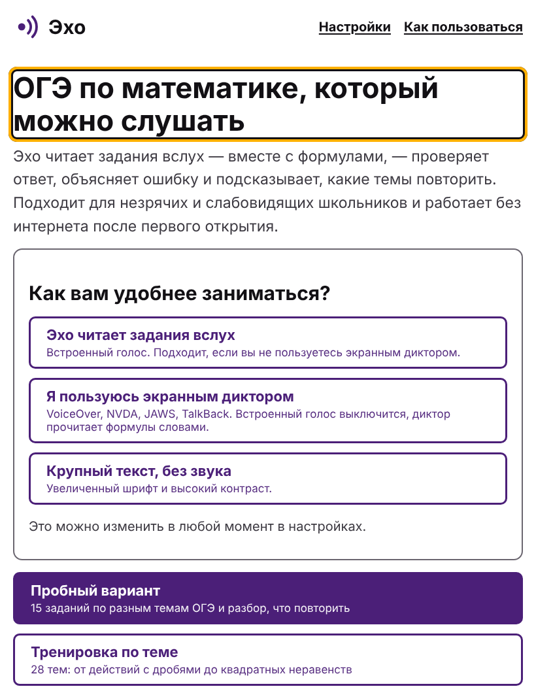
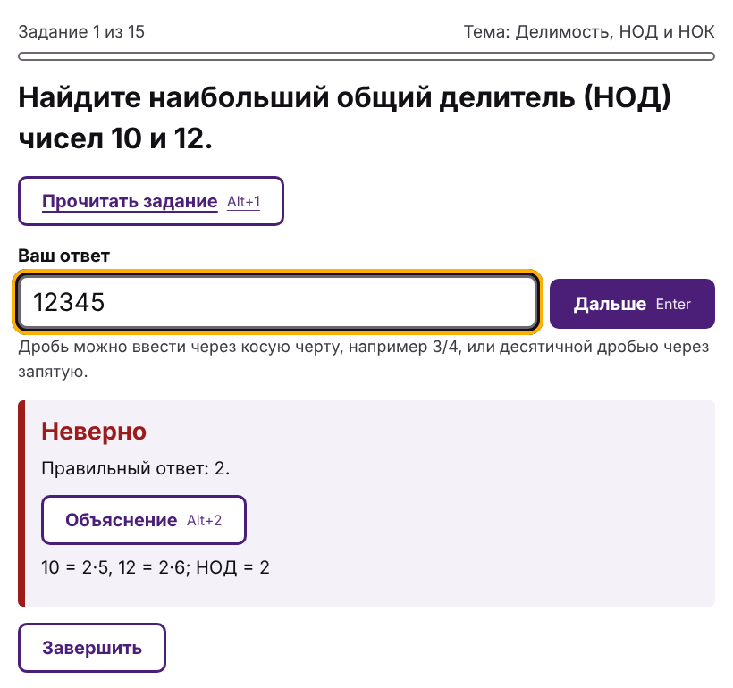
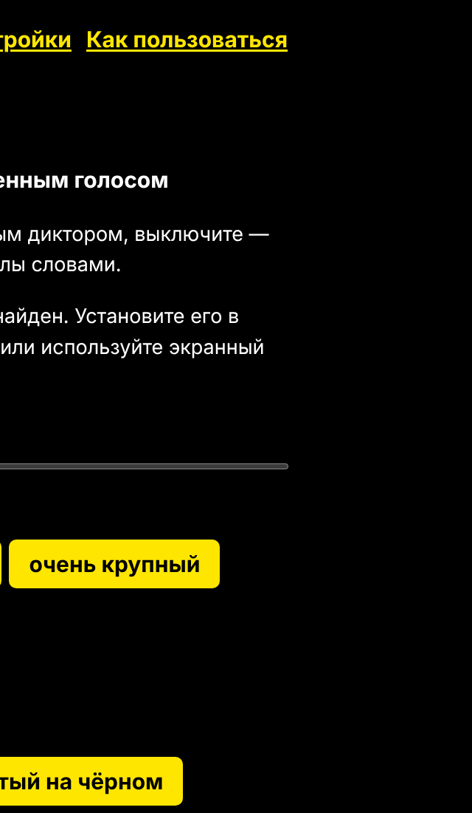
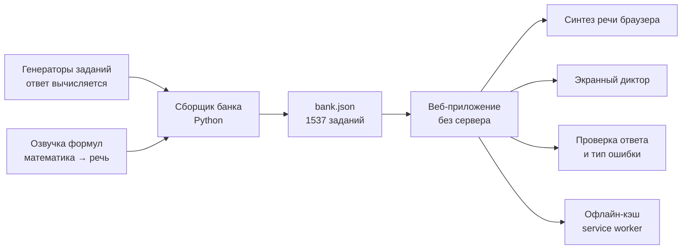

# Эхо — ОГЭ по математике, который можно слушать

**Эхо** — бесплатный тренажёр для подготовки к ОГЭ по математике, созданный в первую очередь для **незрячих и слабовидящих школьников**. Он читает задания вслух вместе с формулами, проверяет ответ, объясняет ошибку и подсказывает, какие темы повторить. Тренажёр работает в браузере на компьютере и телефоне, а после первого открытия — и без интернета.

**Открыть:** https://rustsay.github.io/echo/



## Проблема

Обычные онлайн-тренажёры почти недоступны тем, кто не видит экран. Экранный диктор (VoiceOver, NVDA, TalkBack) читает «x² − 5x + 6 = 0» как набор символов, пропускает степени и индексы, путает дробную черту с делением, а картинки с формулами не читает вообще. Школьнику приходится заниматься только с педагогом, и самостоятельная тренировка становится почти невозможной.

## Что делает Эхо

- **Проговаривает математику словами,** как учитель у доски: «икс в квадрате минус 5 икс плюс 6 равно 0», «дробь: числитель 3, знаменатель 4», «квадратный корень из выражения 9 плюс 16, конец корня», «икс первое и икс второе». Тот же текст получает экранный диктор.
- **Два режима:** пробный вариант (15 заданий по разным темам с разбором, с чего начать) и тренировка по одной из 28 тем ОГЭ.
- **Объясняет ошибку,** а не просто пишет «неверно». Определяется более 40 типов ошибок: знак, положение запятой, потерянный корень, «сложил числители и знаменатели», «не сменил знак неравенства».
- **Подсказывает, с чего начать:** по графу «что нужно знать до чего» отличает тему-первопричину от темы, которая не получается из-за пробела в базе.
- **Подстраивается под ученика:** встроенный голос или экранный диктор, скорость речи, четыре размера шрифта, высокий контраст (жёлтый на чёрном).
- **Полностью управляется с клавиатуры:** <kbd>Enter</kbd> — проверить и дальше, <kbd>Alt</kbd>+<kbd>1</kbd> — прочитать задание ещё раз, <kbd>Alt</kbd>+<kbd>2</kbd> — объяснение, <kbd>Esc</kbd> — остановить речь.
- **Печатает вариант крупным шрифтом** (20 пт) с ответами на отдельной странице — для занятий с педагогом.
- **Работает без интернета и не собирает данные:** прогресс хранится только на устройстве ученика.



## Почему ответам можно доверять

Задания создаются **параметрическими генераторами** из проекта автора [«Маршрут»](https://github.com/rustsay/marshrut): числа подбираются случайно, а ответ **вычисляется** точной арифметикой, а не пишется нейросетью. Ключи проверены **независимо**: тесты разбирают условие и проверяют ответ подстановкой или перебором на сотнях вариантов каждой темы. В банке 1537 уникальных заданий.

Ответы проверяются прямо в браузере. Автотест проверяет, что JavaScript-версия проверки на более чем 4000 разных ответов даёт **тот же результат**, что и протестированная Python-версия.

## Доступность

| Требование | Как сделано |
|---|---|
| Экранные дикторы | Семантическая разметка, заголовки, подписи полей; формулы продублированы словесной версией для диктора; объявления через `aria-live` |
| Только клавиатура | Все действия доступны с клавиатуры, фокус переводится на задание и поле ответа, есть ссылка «Перейти к содержимому» |
| Видимый фокус | Толстая двойная рамка, заметная на светлом и тёмном фоне |
| Контраст | Текст не ниже 7:1 (уровень AAA), отдельная тема «жёлтый на чёрном» |
| Масштаб | Четыре размера шрифта, вёрстка не ломается при увеличении и на телефоне |
| Движение | Анимация индикатора речи отключается при системной настройке «уменьшить движение» |



## Как устроено



- `builder/speech.py` — перевод математической записи в русскую речь (дроби с учётом скобок, корни, степени, индексы, точки на плоскости, латинские буквы).
- `builder/build_bank.py` — сборка банка заданий с готовой озвучкой.
- `builder/engine/` — генераторы, граф тем и проверка (из проекта «Маршрут»).
- `docs/` — сам сайт: `index.html`, `app.js`, `checker.js`, `style.css`, `sw.js`.

## Запуск

Тренажёр — статический сайт, устанавливать ничего не нужно.

```bash
cd docs
python3 -m http.server 8002
```

Откройте http://localhost:8002.

Пересобрать банк заданий (например, после изменения генераторов):

```bash
python3 -m builder.build_bank
```

Тесты:

```bash
python3 -m unittest discover -s tests -t .
```

Тесты проверяют озвучку формул, отсутствие непроговорённых символов во всех заданиях банка, верность всех ключей, совпадение проверки в браузере и в Python, а также независимую проверку генераторов.

## Ограничения и дальнейшие шаги

- Тренажёр пока **не проверялся с незрячими и слабовидящими пользователями.** Следующий шаг — пилот со специализированной школой или региональной организацией Всероссийского общества слепых и доработка по их отзывам.
- Задания с чертежами и графиками не поддерживаются: их нельзя честно озвучить без тактильной графики.
- Качество голоса зависит от синтезатора речи на устройстве. Если русского голоса нет, Эхо предлагает использовать экранный диктор.
- Ответ вводится с клавиатуры. Голосовой ввод — в планах.

## Автор

Сайфуллин Рустам Амирович — Институт искусственного интеллекта, робототехники и системной инженерии КФУ; репетитор по математике.

Разработка велась с использованием генеративного ИИ как ассистента программиста.

Лицензия: MIT.
